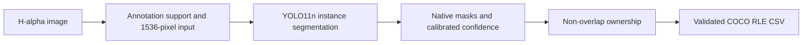

# Solar filament instance segmentation

Used Codex GPT 6 Astra to assist me in this work.

[](https://github.com/ugurk-0/Solar-Filament-Segmentation-Challenge-2026/actions/workflows/tests.yml)

Instance segmentation of solar filaments in 2048 ? 2048 GONG H-alpha observations. The final pipeline uses **YOLO11n-seg**, grouped validation, annotation-support-aware training, and checked COCO RLE export.

**Submitted to Kaggle on 8 November 2026:** submission **58139775**, 1,036 instances over 180 test images. **Public score: 0.28**, up from the previous API-verified **0.23**. See [verified status](reports/final_submission_status.json) and the [submission report](reports/final_submission_20261108.md).

## Selected model

| Item | Retained configuration |
|---|---|
| Model / selected epoch | YOLO11n-seg / 17 |
| Input / output | 1536-pixel inference / native 2048-pixel masks |
| Confidence / minimum area | 0.50 / 128 pixels |
| Instance overlap | Confidence-ordered ownership; disjoint masks |
| TTA | Disabled, matching validation |
| Local mean / pooled PQ | **0.3199 / 0.3319** |

Epoch selection uses 16 monitoring observations; confidence and area are calibrated on 40 different observations. The assessment uses 85 reused research observations. These local scores are not leaderboard scores. Against the promoted U-Net/skeleton baseline, paired mean PQ improved by 0.0307, with bootstrap 95% interval [0.0051, 0.0566]. See [the measured experiment](reports/yolo11n_20261003.md).



## Reproduce and inspect

Use Python 3.12 with a CUDA-compatible PyTorch installation in a separate environment:

```bash
python -m pip install -r requirements-yolo.txt
python -m pytest tests -q
python submit_yolo.py --output submissions/reproduced
```

Export requires the retained local checkpoint `runs/yolo11n_20261003/best_pq.pt`, its selection/protocol files, and the competition test images. Datasets, trained weights, submissions and large run outputs are not bundled. A fresh clone can run synthetic tests and train from scratch; it cannot immediately reproduce the CSV without those artifacts.

For training and data preparation, see [the YOLO guide](docs/YOLO_EXPERIMENT.md). Open [notebook.ipynb](notebook.ipynb) to inspect the selected model's epoch curves and saved predictions. Install `requirements-notebook.txt` for its dashboard. The notebook displays artifacts and does not silently start training or submit to Kaggle.

## Engineering and evidence

- Physical-observation grouping prevents duplicate annotator records leaking across splits.
- Epoch selection uses instance PQ, rather than training loss or detector mAP alone.
- Native mask geometry, annotation support, model identity, non-overlap ownership and RLE round trips are checked.
- The final CSV is tied to checkpoint, source, settings and image hashes.
- The retained regression suite passes **40 tests**. Historical method-only tests were removed with their retired implementations.

| Entry point | Role |
|---|---|
| [submit_yolo.py](submit_yolo.py) | Reproduce the validated final CSV |
| [experiment_yolo.py](experiment_yolo.py) | Winning experiment protocol |
| [train_yolo_experiment.py](train_yolo_experiment.py) | Identity-checked training runner |
| [yolo_training.py](yolo_training.py), [yolo_prediction.py](yolo_prediction.py) | Support-aware training and native mask reconstruction |
| [instance_metrics.py](instance_metrics.py) | Shared cached-IoU scoring |
| [solution.py](solution.py), [skeleton_merge.py](skeleton_merge.py) | Retained historical U-Net baseline and promoted post-processing |
| [reports/](reports/) | Measured results, including rejected experiments |

Rejected experimental implementations have been removed from the active codebase. Their results remain in the [cleanup ledger](reports/final_submission_20261108.md), reports, and Git history. The original [LaTeX report](main.tex) describes the historical U-Net work; the final model is documented in the YOLO and submission reports.

## Limits

The assessment split was reused during research; there is no untouched final local estimate or multi-seed/fold confirmation. The support geometry is approximate and grouping does not eliminate temporal correlation. No unseen leaderboard score is inferred from local results.

Data originate from MAGFiLO and NSO/GONG and remain subject to the competition terms. Ultralytics is an optional dependency under its published license; see the YOLO guide. Data and trained weights are not redistributed here.
